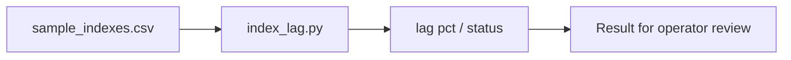

# Embedding Index Lag Watcher architecture

Detects vector index lag by comparing produced, indexed, and queryable embedding counts.

## Operational boundaries

The documented run evaluates the bundled sample locally. Results depend on the quality and scope of the input. The demo makes no live infrastructure changes.
